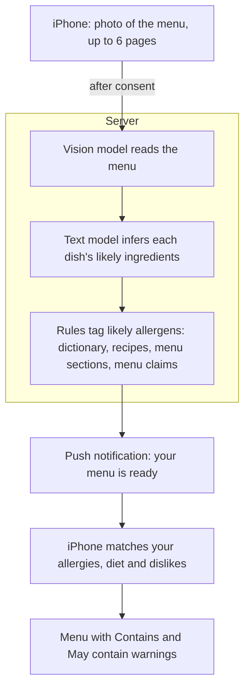

# How a scan works

1. Photograph a menu, up to 6 pages. The first time, the app asks before any photo goes to OpenAI.
2. The app uploads the photos and creates a scan job. A server function analyzes the menu while you're free to leave the app.
3. A push notification says it's ready.
4. You browse the menu with its warnings, tap any ingredient for an explanation, hide flagged dishes and save the menu.

## Design points

- **All AI runs on the server.** The app never holds an AI key, and a scan survives closing the app.
- **Two AI stages.** A vision model (GPT-4.1) reads the menu, then a cheaper text model (GPT-4o-mini) infers each dish's ingredients. Every dish keeps a fixed ID, so two dishes with the same name can never share each other's ingredients. That was an early bug that could have hidden an allergen.
- **The AI suggests; the rules decide.** On top of the AI sit a 1,264-term allergen dictionary, recipe knowledge ("Caesar dressing usually contains anchovy"), menu-section rules (a "Wines" section implies alcohol) and claim reading ("Dairy Free," "no peanuts," "choice of"). The rules decide what you're told and how certain it sounds.
- **A shared ingredient knowledge base.** Each new ingredient gets one explanation, written once and reused. That cuts AI cost and keeps the wording consistent.
- **Built for real failure.** Network blips, server timeouts and AI outages each have a defined outcome, a refund rule and a message for the user. Scanning can be paused in production without a release.

## Stack

React Native (Expo) and TypeScript on iPhone · Supabase (Postgres, auth, storage and edge functions) · OpenAI (GPT-4.1 and GPT-4o-mini) · Apple In-App Purchase, DeviceCheck and Sign in with Apple · Sentry and Mixpanel
