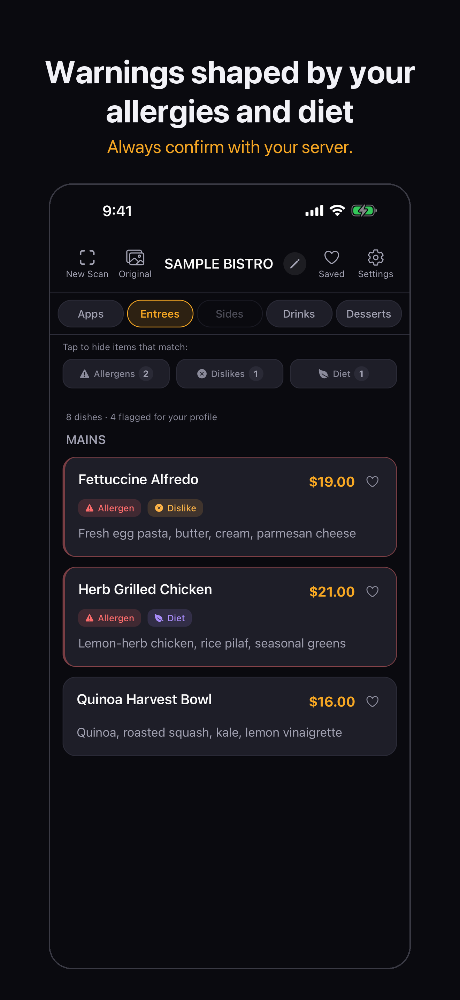
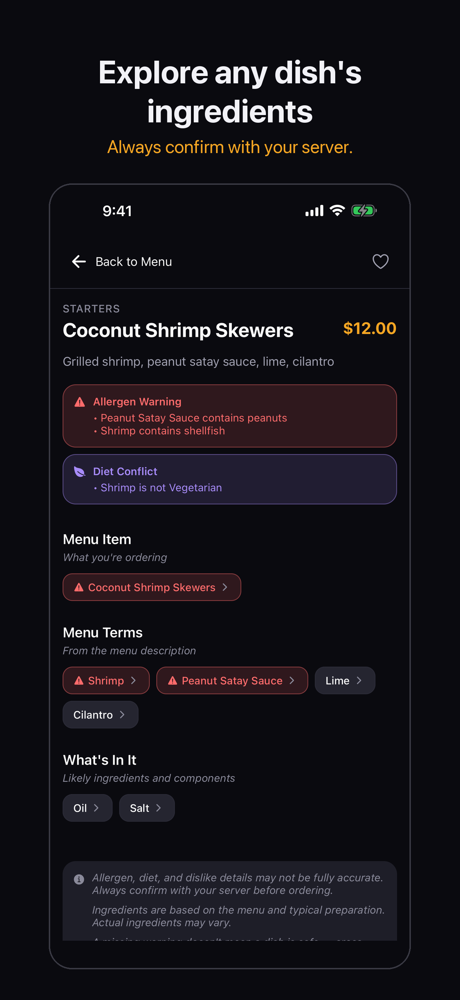
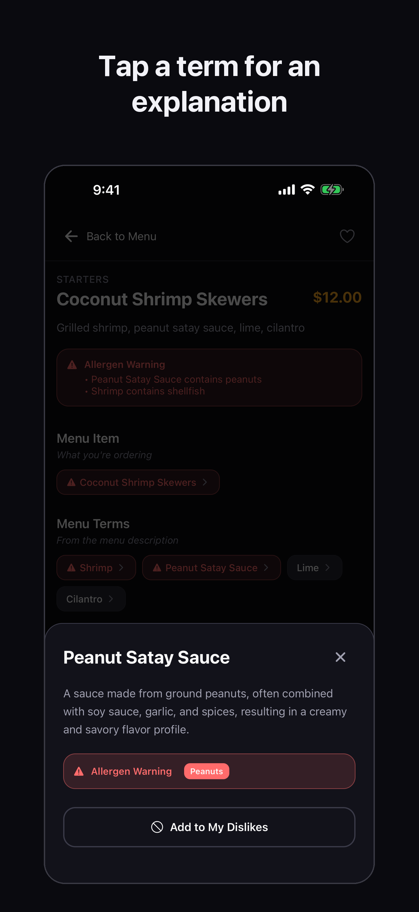

# MenuVision: building an allergy-aware menu app by leading AI agents

MenuVision is an iPhone app that turns a photo of any restaurant menu into a personal one: every dish with its likely ingredients, and warnings shaped by your allergies, diet and dislikes. It never calls a dish safe.

**Status:** live on the App Store since November 2026. · [Get it on the App Store](https://apps.apple.com/us/app/menuvision/id6756634138) · [menuvisionapp.com](https://www.menuvisionapp.com) · [The film (1:49)](https://www.menuvisionapp.com/tour)

This repo is the story, not the code. MenuVision is a commercial app and its code is private. Here you'll find the calls that shaped it, how I ran a team of AI agents to build it, and how a scan works.

  
  
  

*Illustrative screens on a fictional menu. Always confirm with restaurant staff.*

## Why

At a restaurant, someone with a food allergy, a religious diet or a strong dislike needs a fast answer they can trust: what can I eat here? Menus are inconsistent, and staff can't always help in the moment.

## How I built it

I'm a project manager, not a career software engineer. So I ran MenuVision like a product team with AI in the engineering seats:

- **Lead engineer:** Claude Code wrote and integrated the code, ran the tests, and kept the docs and decision log current.
- **Independent auditor:** a separate OpenAI model reviewed every round of changes with one brief: find what would hurt a real user.
- **Me:** product owner. I made every product, safety, privacy, money and launch call, tested every build on my iPhone, and approved every production change.

It went from an empty repository on December 14, 2025 to a launch candidate in under ten months. The method is in [PLAYBOOK.md](PLAYBOOK.md).

## The call that defines it

By September 2026 the app was feature-complete. I test it dish by dish: should a dairy allergy flag this cheeseburger? This churro? An allergy app can be wrong two ways, and they aren't equal. A false alarm costs you a question to your server. A miss can cost far more. So I set two bars before I'd submit: catch over 99% of allergens, and keep false alarms under 5%.

When it first looked done, it caught about 95-96% of allergens in my testing. For most apps that's a launch. For an allergy app, it isn't.

On September 20 an independent audit returned NO-GO, and I agreed. I kept submission closed through two more weeks of fix rounds, each followed by a fresh audit. Every miss the auditors found was fixed as a class, not just for the menu that exposed it, and locked in with tests. I held until my testing cleared both bars and every known way of missing an allergen was fixed or made to warn.

## Other calls

- **Say how sure you are.** "Contains" only when the menu names the ingredient. Anything inferred says "May contain."
- **Be wrong in the safe direction.** A fix that removed false alarms on cake-flavored cocktails also caused missed warnings on real desserts. We reverted it the same day.
- **Safe defaults, one floor.** Users can limit diet and dislike warnings to what's printed on the menu. Allergy warnings can't be hidden by accident.
- **Privacy is part of the product.** The app asks before any photo goes to OpenAI, and allergies and diets never reach analytics.
- **Never charge for our failures.** If the AI or our server fails, the scan is refunded.

Each one, with the situation and what I rejected, is in [DECISIONS.md](DECISIONS.md).

## By the numbers

| | |
|---|---|
| Allergens caught, in my hands-on testing | **Over 99%** (the bar I set) |
| Checks free of false alarms | **Over 95%** (the bar I set) |
| Allergens caught when it first looked done | ~95-96% |
| Independent audits | 80+ numbered audit rounds |
| Recorded product and architecture decisions | 175 |
| Automated tests | 24,750, most of them data-driven cases |
| Regression check on real menus | 0 lost warnings in a run over 208 saved menus (10,106 dishes) and 43 preference profiles. It checks that a change never dropped a warning the app already gave. It doesn't measure accuracy. |
| Scan time | ~5 minutes to ~80 seconds after I proposed running the AI steps in parallel (early 2026) |
| Allergen dictionary | 1,264 terms |
| Ingredient explanations | 4,776 (October 2026), in one house style |

## What I learned

- **"Almost right" is a product decision, not a technical one.** The last few percent of allergy accuracy took as much work as the first 95, and deciding it was worth it was my call.
- **Certainty is part of the answer.** "May contain" isn't a hedge. It tells you how we know.
